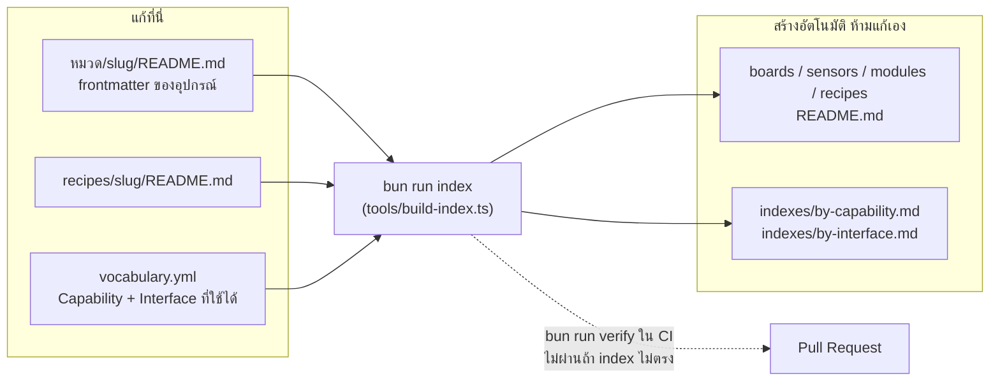

# Hardware Library

คลังข้อมูลบอร์ดและเซนเซอร์ที่ทีม Globaltronic Intertrade ใช้งานจริง ทั้ง ESP32, ESP8266, micro:bit, Arduino, Raspberry Pi และเซนเซอร์/โมดูลต่างๆ แต่ละอุปกรณ์มีลักษณะอุปกรณ์ pin/port วิธีต่อสาย วิธีใช้งาน การประยุกต์ใช้ และ source code พื้นฐานที่ทดสอบกับของจริงแล้ว
เขียนให้ทีมใช้เป็นหลัก และเปิด public ให้ลูกค้าดูได้

|         |                                                                          |
| ------- | ------------------------------------------------------------------------ |
| เจ้าของ  | Globaltronic Intertrade (ทีม Edutronics)                                  |
| ภาษา    | ไทย + ศัพท์เทคนิคภาษาอังกฤษ                                                  |
| เครื่องมือ | Markdown บน GitHub · [Bun](https://bun.sh) สำหรับสร้างหน้า index และเช็กข้อมูล |

## ค้นหาอุปกรณ์

| ต้องการ                                      | เปิด                                                  |
| ------------------------------------------- | ---------------------------------------------------- |
| บอร์ดทั้งหมด                                   | [boards/](boards/README.md)                          |
| เซนเซอร์ทั้งหมด                                | [sensors/](sensors/README.md)                        |
| โมดูล (รีเลย์ จอ ขับมอเตอร์ สื่อสาร ฯลฯ)           | [modules/](modules/README.md)                        |
| งานที่ใช้หลายอุปกรณ์ร่วมกัน                        | [recipes/](recipes/README.md)                        |
| หาตามสิ่งที่วัดหรือทำได้ (อุณหภูมิ ระยะทาง Wi-Fi ...) | [indexes/by-capability.md](indexes/by-capability.md) |
| หาตามวิธีเชื่อมต่อ (I2C, SPI, RS485 ...)         | [indexes/by-interface.md](indexes/by-interface.md)   |

อุปกรณ์ที่ทำได้หลายอย่าง (เช่น วัดได้ทั้งอุณหภูมิและความชื้น) จะอยู่ในหน้า index ทุกหัวข้อที่เกี่ยวข้อง
สถานะ: 🟢 `tested` ทดสอบกับของจริงแล้ว · 🟡 `draft` ยังไม่ได้ทดสอบหรือข้อมูลยังไม่ครบ · ⚪ `deprecated` เลิกใช้แล้ว

## การทำงาน

ข้อมูลของแต่ละอุปกรณ์อยู่ที่ส่วนหัว (frontmatter) ของ `README.md` ในโฟลเดอร์อุปกรณ์นั้น หน้า index ทั้งหมดสร้างจากข้อมูลส่วนนี้อัตโนมัติ



## เริ่มใช้งาน (สำหรับคนเพิ่ม/แก้ข้อมูล)

ต้องมี [Bun](https://bun.sh) และ git

```bash
bun install
```

```bash
bun run index
```

```bash
bun run verify
```

| คำสั่ง             | ทำอะไร                                             |
| ---------------- | -------------------------------------------------- |
| `bun run index`  | เช็กข้อมูลทุกหน้า แล้วสร้างหน้า index ใหม่                  |
| `bun run verify` | เช็กว่าข้อมูลถูกและ index ตรง + เช็ก format (CI รันคำสั่งนี้) |
| `bun run format` | จัด format ไฟล์ทั้งหมดด้วย Prettier                     |

**กติกาการเพิ่ม แก้ไข ลบ: [CONTRIBUTING.md](CONTRIBUTING.md)** · ความหมายของคำ: [CONTEXT.md](CONTEXT.md)

## โครงสร้าง

| Path                                                     | คืออะไร                          |
| -------------------------------------------------------- | ------------------------------- |
| `boards/<slug>/` · `sensors/<slug>/` · `modules/<slug>/` | อุปกรณ์ 1 รุ่น = 1 โฟลเดอร์          |
| `<slug>/README.md`                                       | ข้อมูลอุปกรณ์ (frontmatter + เนื้อหา) |
| `<slug>/examples/<บอร์ด>/`                                | โค้ดตัวอย่างที่ทดสอบกับบอร์ดนั้น         |
| `<slug>/images/`                                         | รูปที่ถ่ายเอง                       |
| `recipes/<slug>/`                                        | การประยุกต์ใช้หลายอุปกรณ์ร่วมกัน       |
| `indexes/`                                               | หน้า index (สร้างอัตโนมัติ)          |
| `templates/`                                             | แม่แบบหน้าอุปกรณ์และ Recipe         |
| `vocabulary.yml`                                         | ค่า Capability / Interface ที่ใช้ได้ |
| `tools/build-index.ts`                                   | ตัวเช็กข้อมูลและสร้าง index          |
| `docs/adr/`                                              | บันทึกการตัดสินใจ                   |

## ความปลอดภัย

repo นี้เป็น public ห้ามมีชื่อลูกค้า ราคา รหัสผ่าน token หรือ IP ภายใน ([docs/adr/0001](docs/adr/0001-public-repo-no-private-data.md)) · เปิด secret scanning + push protection ของ GitHub ไว้ช่วยกันอีกชั้น

## สำหรับ AI

ดู [AGENTS.md](AGENTS.md)
