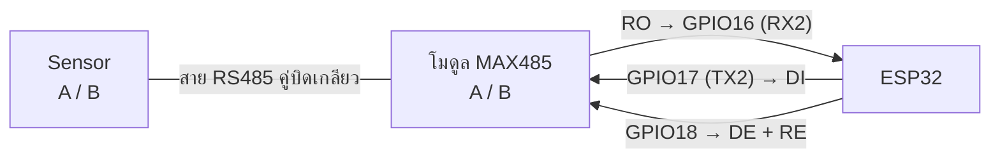

# RS485 Modbus Temperature & Humidity Sensor

> **รุ่นที่ทดสอบ:** Meteorological multi-element louver box (Type 485) **VMS-300BYH-M** Ver 2.0 — กล่องกันแดดสำหรับติดตั้งกลางแจ้ง
> datasheet ไม่มีให้ดาวน์โหลดจากผู้ขาย จึงลิงก์ไปที่ฉบับบน Scribd
> รุ่นนี้บางแบบวัดความดันอากาศได้ด้วย แต่ยังไม่ได้ทดสอบค่าความดัน หน้านี้จึงยืนยันแค่อุณหภูมิและความชื้น

## ลักษณะอุปกรณ์

- วัดอุณหภูมิและความชื้นในอากาศ ส่งค่าเป็นตัวเลขผ่าน Modbus RTU บนสาย RS485
- RS485 เป็นสายคู่บิดเกลียว (A/B) เดินสายได้ไกลหลายร้อยเมตรและทนสัญญาณรบกวนกว่า I2C/analog จึงเหมาะกับโรงเรือนหรือโรงงาน
- ต่อเซนเซอร์หลายตัวบนสายเส้นเดียวได้ แต่ละตัวต้องตั้ง **Modbus address ไม่ซ้ำกัน**
- บอร์ด ESP32 / Arduino ไม่มีขา RS485 ในตัว ต้องใช้โมดูลแปลง TTL ↔ RS485 (เช่น MAX485)

### Register map (ตามรุ่นที่ทีมใช้)

| Register (holding, function 03) | ค่า      | การแปลง                               |
| ------------------------------- | -------- | ------------------------------------- |
| 0                               | ความชื้น | ÷ 10 → %RH                            |
| 1                               | อุณหภูมิ | อ่านเป็น signed 16-bit แล้ว ÷ 10 → °C |

- รุ่น VMS-300BYH-M: datasheet ระบุให้อ่านความชื้น/อุณหภูมิที่ **register 500 / 501** (ลำดับและการแปลงเหมือนตารางด้านบน) ทดสอบแล้วว่าอ่านที่ **0 / 1** ได้ค่าเดียวกัน ตัวอย่างในหน้านี้ใช้ 0 / 1 ถ้าอ่านไม่ได้ให้ลองเปลี่ยนเป็น 500
- ค่าตั้งต้นจากโรงงานที่ทดสอบ: address **1** · **9600** baud · 8N1
- รุ่นอื่นอาจใช้ input register (function 04) หรือสลับลำดับ ให้เช็ก datasheet ก่อนเสมอ

## Pin / Port

| สาย      | หน้าที่                           |
| -------- | --------------------------------- |
| V+ / VCC | ไฟเลี้ยงตาม datasheet             |
| V- / GND | กราวด์ (ต่อร่วมกับกราวด์ของบอร์ด) |
| A (D+)   | RS485 A                           |
| B (D-)   | RS485 B                           |

## การต่อสาย

| MAX485              | ESP32          |
| ------------------- | -------------- |
| RO                  | GPIO16 (RX2)   |
| DI                  | GPIO17 (TX2)   |
| DE + RE (ต่อรวมกัน) | GPIO18         |
| VCC / GND           | ไฟเลี้ยง / GND |

- เซนเซอร์ใช้ไฟ 9–30V จาก**แหล่งจ่ายแยก** — ต่อ GND ของแหล่งจ่ายร่วมกับ GND ของ ESP32/MAX485 เสมอ
- ⚠️ ESP32 ทนไฟที่ขา GPIO ได้ 3.3V — ตอนทดสอบเลี้ยงโมดูล MAX485 ด้วย 5V อ่านค่าได้ปกติ แต่ขา RO ส่ง 5V เข้า GPIO16 เกินสเปก ใช้งานจริงให้เปลี่ยนเป็นโมดูล 3.3V (เช่น MAX3485 / SP3485) หรือใส่ตัวแบ่งแรงดันที่ขา RO
- สายยาวหรือต่อหลายตัว: ใส่ตัวต้านทาน 120Ω คร่อม A–B ที่ปลายสายทั้งสองด้าน

## วิธีใช้งาน

1. Arduino IDE → Library Manager → ติดตั้ง **ModbusMaster** (Doc Walker)
2. เปิด [`examples/esp32-devkit/esp32-devkit.ino`](examples/esp32-devkit/esp32-devkit.ino) แก้ `SENSOR_ADDRESS` และ `BAUD_RATE` ให้ตรงกับเซนเซอร์
3. เลือกบอร์ด **ESP32 Dev Module** แล้วอัปโหลด
4. เปิด Serial Monitor ที่ 115200 จะเห็น `humidity: 55.3 %RH | temperature: 29.8 °C` ทุก 5 วินาที

## Examples

| บอร์ด                                                 | โฟลเดอร์                                           | ทดสอบเมื่อ | ผู้ทดสอบ |
| ----------------------------------------------------- | -------------------------------------------------- | ---------- | -------- |
| ESP32 DevKit V1 + MAX485 (5V) · เซนเซอร์ VMS-300BYH-M | [`examples/esp32-devkit/`](examples/esp32-devkit/) | 2026-11-26 | momaymon |

## การประยุกต์ใช้

- วัดอุณหภูมิ/ความชื้นหลายจุดในโรงเรือนหรือโกดังด้วยสายเส้นเดียว แล้วส่งขึ้น dashboard ผ่าน Wi-Fi ของ ESP32
- ใช้คู่กับรีเลย์สั่งพัดลมหรือพ่นหมอกเมื่อค่าเกินเกณฑ์

## ปัญหาที่เจอ

| อาการ                                         | สาเหตุ                      | วิธีแก้                                                                |
| --------------------------------------------- | --------------------------- | ---------------------------------------------------------------------- |
| อ่านค่าไม่ได้เป็นบางรอบ (Modbus error)        | frame หลุดบนสาย             | retry 2–3 ครั้ง ห่างกัน ~300 ms ก่อนถือว่าอ่านไม่ได้                   |
| ต่อหลายตัวแล้วอ่านพลาดบ่อย                    | ยิงคำสั่งถี่เกินไป          | อ่านทีละตัว เว้น ~3 วินาทีระหว่างแต่ละ address                         |
| บางรอบได้อุณหภูมิ 0.0 หรือความชื้น < 1        | ค่าผิดปกติจากเซนเซอร์       | กรองค่าทิ้ง (หรือใช้ค่าล่าสุดแทน) ก่อนส่งขึ้นระบบ                      |
| อุณหภูมิติดลบแสดงเป็น ~6553 °C                | อ่าน register เป็น unsigned | cast เป็น `int16_t` ก่อนหาร 10 (ทำไว้ในตัวอย่างแล้ว)                   |
| ไม่รู้ baud ของเซนเซอร์                       | ป้ายไม่ระบุ                 | สแกนลองทั้ง 4800 และ 9600 แล้วดูว่า baud ไหนตอบ (VMS-300BYH-M = 9600)  |
| อ่าน holding 2–9 ได้ 0 หมด หาค่าความดันไม่เจอ | ความดันไม่ได้อยู่ช่วง 0–9   | ยังไม่ได้ทดสอบ — ดูตาราง register ใน datasheet หรือสแกนช่วง 500 ขึ้นไป |

## อ้างอิง

- [ModbusMaster library](https://github.com/4-20ma/ModbusMaster)
