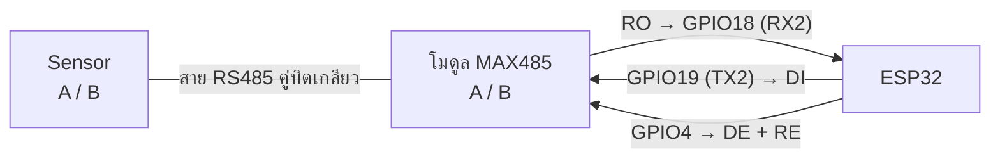

# RS485 Modbus Temperature & Humidity Sensor

> **สถานะ draft** — เขียนจากโค้ดที่ทีมเคยใช้งานจริงกับ ESP32 แต่ยังต้องยืนยัน 3 อย่างก่อนเปลี่ยนเป็น `tested`:
> ชื่อรุ่น/ยี่ห้อของเซนเซอร์ (+ ลิงก์ datasheet) · รุ่นบอร์ด ESP32 ที่ใช้ · ไฟเลี้ยงของโมดูล MAX485

## ลักษณะอุปกรณ์

- วัดอุณหภูมิและความชื้นในอากาศ ส่งค่าเป็นตัวเลขผ่าน Modbus RTU บนสาย RS485
- RS485 เป็นสายคู่บิดเกลียว (A/B) เดินสายได้ไกลหลายร้อยเมตรและทนสัญญาณรบกวนกว่า I2C/analog จึงเหมาะกับโรงเรือนหรือโรงงาน
- ต่อเซนเซอร์หลายตัวบนสายเส้นเดียวได้ แต่ละตัวต้องตั้ง **Modbus address ไม่ซ้ำกัน**
- บอร์ด ESP32 / Arduino ไม่มีขา RS485 ในตัว ต้องใช้โมดูลแปลง TTL ↔ RS485 (เช่น MAX485)

### Register map (ตามรุ่นที่ทีมใช้)

| Register (holding, function 03) | ค่า     | การแปลง                            |
| ------------------------------- | ------ | ---------------------------------- |
| 0                               | ความชื้น | ÷ 10 → %RH                         |
| 1                               | อุณหภูมิ  | อ่านเป็น signed 16-bit แล้ว ÷ 10 → °C |

รุ่นอื่นอาจใช้ input register (function 04) หรือสลับลำดับ ให้เช็ก datasheet ก่อนเสมอ

## Pin / Port

| สาย      | หน้าที่                        |
| -------- | --------------------------- |
| V+ / VCC | ไฟเลี้ยงตาม datasheet         |
| V- / GND | กราวด์ (ต่อร่วมกับกราวด์ของบอร์ด) |
| A (D+)   | RS485 A                     |
| B (D-)   | RS485 B                     |

## การต่อสาย

| MAX485            | ESP32        |
| ----------------- | ------------ |
| RO                | GPIO18 (RX2) |
| DI                | GPIO19 (TX2) |
| DE + RE (ต่อรวมกัน) | GPIO4        |
| VCC / GND         | ไฟเลี้ยง / GND |

- ⚠️ ESP32 ทนไฟที่ขา GPIO ได้ 3.3V — ถ้าโมดูล MAX485 เลี้ยงด้วย 5V ขา RO จะส่ง 5V เข้า ESP32 ให้ใช้โมดูล 3.3V (เช่น MAX3485 / SP3485) หรือใส่ตัวแบ่งแรงดัน
- สายยาวหรือต่อหลายตัว: ใส่ตัวต้านทาน 120Ω คร่อม A–B ที่ปลายสายทั้งสองด้าน

## วิธีใช้งาน

1. Arduino IDE → Library Manager → ติดตั้ง **ModbusMaster** (Doc Walker)
2. เปิด [`examples/esp32-devkit/esp32-devkit.ino`](examples/esp32-devkit/esp32-devkit.ino) แก้ `SENSOR_ADDRESS` และ `BAUD_RATE` ให้ตรงกับเซนเซอร์
3. เลือกบอร์ด **ESP32 Dev Module** แล้วอัปโหลด
4. เปิด Serial Monitor ที่ 115200 จะเห็น `humidity: 55.3 %RH | temperature: 29.8 °C` ทุก 5 วินาที

## Examples

| บอร์ด             | โฟลเดอร์                                            | ทดสอบเมื่อ | ผู้ทดสอบ |
| ---------------- | -------------------------------------------------- | -------- | ------ |
| ESP32 (รอยืนยันรุ่น) | [`examples/esp32-devkit/`](examples/esp32-devkit/) | รอยืนยัน   | รอยืนยัน |

## การประยุกต์ใช้

- วัดอุณหภูมิ/ความชื้นหลายจุดในโรงเรือนหรือโกดังด้วยสายเส้นเดียว แล้วส่งขึ้น dashboard ผ่าน Wi-Fi ของ ESP32
- ใช้คู่กับรีเลย์สั่งพัดลมหรือพ่นหมอกเมื่อค่าเกินเกณฑ์

## ปัญหาที่เจอ

| อาการ                             | สาเหตุ                     | วิธีแก้                                           |
| --------------------------------- | ------------------------- | ---------------------------------------------- |
| อ่านค่าไม่ได้เป็นบางรอบ (Modbus error) | frame หลุดบนสาย            | retry 2–3 ครั้ง ห่างกัน ~300 ms ก่อนถือว่าอ่านไม่ได้     |
| ต่อหลายตัวแล้วอ่านพลาดบ่อย             | ยิงคำสั่งถี่เกินไป              | อ่านทีละตัว เว้น ~3 วินาทีระหว่างแต่ละ address         |
| บางรอบได้อุณหภูมิ 0.0 หรือความชื้น < 1   | ค่าผิดปกติจากเซนเซอร์         | กรองค่าทิ้ง (หรือใช้ค่าล่าสุดแทน) ก่อนส่งขึ้นระบบ          |
| อุณหภูมิติดลบแสดงเป็น ~6553 °C         | อ่าน register เป็น unsigned | cast เป็น `int16_t` ก่อนหาร 10 (ทำไว้ในตัวอย่างแล้ว) |

## อ้างอิง

- [ModbusMaster library](https://github.com/4-20ma/ModbusMaster)
